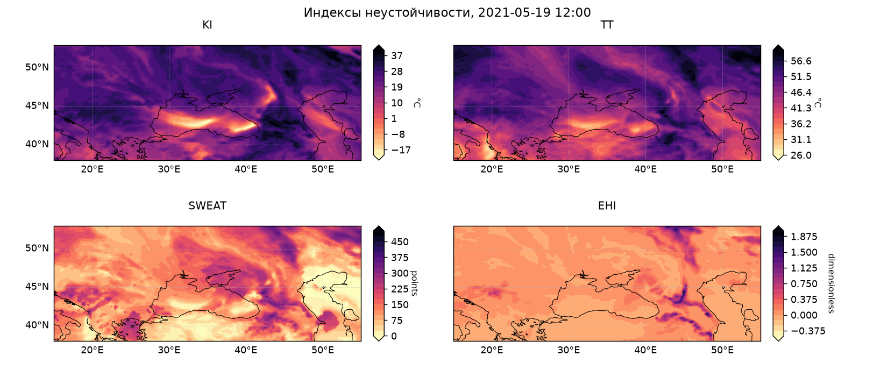
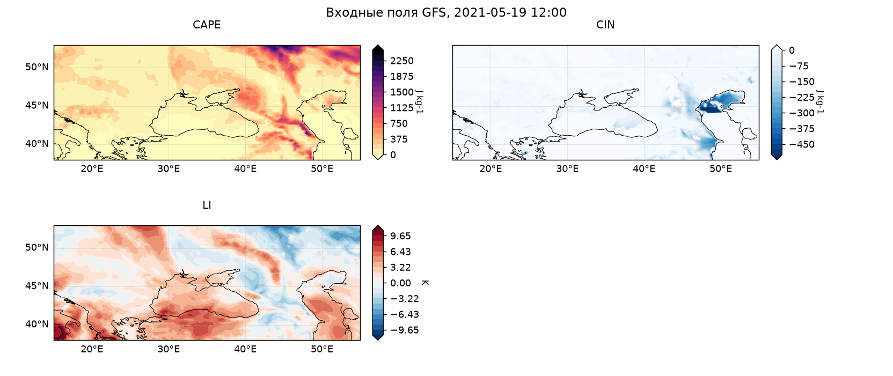
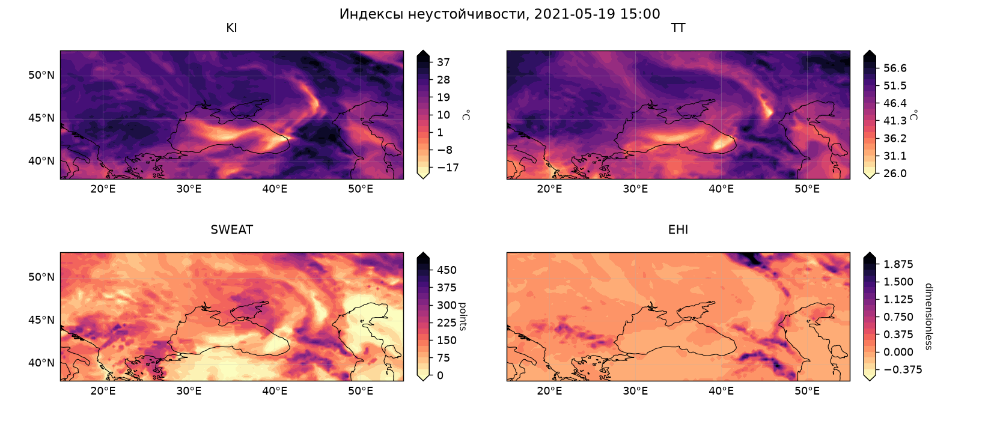
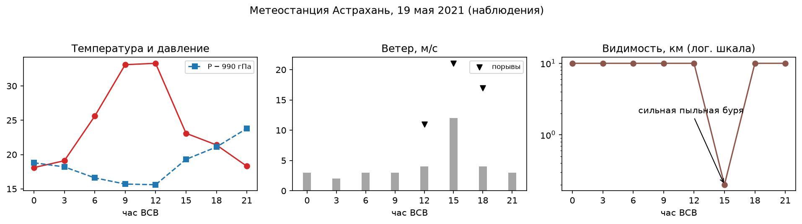
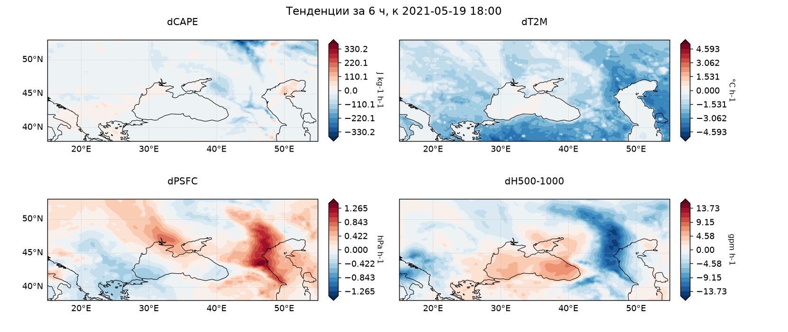

# AtmoStab — индексы неустойчивости атмосферы по прогнозам GFS

**Библиотека для расчёта индексов атмосферной неустойчивости
(KI, TT, TI, SWEAT, KO, DCI, EHI, BRN, UVV) по полям глобальной модели
GFS 0.25°. Сырые GRIB2-файлы читаются напрямую — свежий запуск модели
превращается в карты индексов за минуты после публикации данных.**
Проект основан на выпускной квалификационной работе
[«Влияние неустойчивости на динамику атмосферных процессов»](http://elib.rshu.ru/files_books/pdf/rid_f5f08ae166bc4845bbd6b7aeedaf7f36.pdf)
(РГГМУ, 2022): случай опасного явления из работы воспроизведён средствами
пакета и приведён ниже в демонстрационных целях.

CAPE, CIN и Lifted index пакет не рассчитывает — они есть среди штатных
полей прогноза GFS; библиотека скачивает их вместе с остальными полями и
использует как входные данные для TI, DCI, EHI, BRN и UVV. Итого из
прогнозных данных доступны все 12 величин.

> **EN abstract.** A library for computing atmospheric instability indices
> (K-index, Total Totals, Thompson, SWEAT, KO, DCI, EHI, BRN, updraft
> velocity) from NCEP GFS 0.25° **forecasts**. Raw GRIB2 files are read
> directly via cfgrib — no preprocessing — so a fresh model run becomes
> index maps minutes after publication; CAPE/CIN/Lifted Index come from
> the native GFS forecast fields and serve as inputs. Vectorized xarray
> implementation with tests, a CLI, and a data downloader (only the
> needed GRIB messages are fetched: ~50 MB instead of ~450 MB). Based on
> a bachelor's thesis on the Astrakhan dust storm of 19 May 2021 —
> reproduced below as a demonstration.

## Быстрый старт

```bash
pip install -e .            # или: uv pip install -e .

# скачать прогноз свежего запуска GFS (06 ВСВ) на +12 ч
atmostab-download $(date +%F) --hours 6 --forecast-hours 12 --out data/gfs

# построить карты выбранных индексов для региона
# (--inputs добавит карты входных полей CAPE/CIN/LI)
atmostab data/gfs/*.grib2 --index KI,TT,SWEAT,EHI --inputs -o figures --region 15,55,38,53
```

Тесты:

```bash
pip install -e ".[test]"
pytest
```

Пример в коде:

```python
import atmostab
from atmostab import indices

ds = atmostab.open_gfs("data/gfs/gfs_20261011_06_f012.grib2",
                       region=(15, 55, 38, 53))   # xarray.Dataset
sweat = indices.swet(ds)   # каждый индекс — отдельная функция,
ki = indices.k_index(ds)   # вызывающий код явно перечисляет нужные
atmostab.plotting.panel({"SWEAT": sweat, "KI": ki},
                        suptitle="Прогноз на 18:00 ВСВ", path="panel.png")
```

В CLI индексы обязательно перечисляются в `--index`; заголовки карт и
тенденции строятся по **сроку действия прогноза** (valid_time), а не по
времени запуска модели.

## Параметры запуска

### `atmostab` — расчёт индексов и карты

```bash
atmostab ФАЙЛЫ... --index ИНДЕКСЫ [-o КАТАЛОГ] [--region З,В,Ю,С] [--inputs] [--tendency] [--dpi N]
```

| Параметр | Описание |
|---|---|
| `ФАЙЛЫ...` | один или несколько файлов данных GFS — сырые GRIB2 или NetCDF-вырезки; несколько сроков подряд нужны для `--tendency` |
| `--index` (обязательный) | индексы к расчёту: `KI, TT, TI, SWEAT, KO, DCI, EHI, BRN, UVV` — через запятую или повторением флага, регистр не важен; неизвестное имя — ошибка со списком доступных |
| `-o, --output-dir` | каталог для PNG-карт (по умолчанию `figures`) |
| `--region З,В,Ю,С` | вырезка области в градусах, например `15,55,38,53`; без неё глобальный GRIB2 обрабатывается целиком |
| `--inputs` | дополнительно построить карты входных полей GFS: CAPE, CIN, Lifted index |
| `--tendency` | карты тенденций (CAPE, температура у земли, давление, толщина 500/1000 гПа) между соседними сроками; интервал берётся из сроков действия |
| `--dpi` | разрешение сохраняемых карт (по умолчанию 150) |

Результат на каждый входной файл: `*_core.png` — KI, TT, SWEAT, EHI;
`*_extra.png` — TI, DCI, KO, BRN, UVV; `*_inputs.png` — с флагом
`--inputs`; `*_tendency.png` — с флагом `--tendency`.

### `atmostab-download` — скачивание данных

```bash
atmostab-download ДАТЫ... [--hours Ч,Ч] [--forecast-hours Ч,Ч] [--out КАТАЛОГ] [--source noaa\|gdex] [--cookie ...] [--insecure]
```

| Параметр | Описание |
|---|---|
| `ДАТЫ...` | даты запусков модели, `ГГГГ-ММ-ДД` |
| `--hours` | сроки запусков через запятую, ВСВ (по умолчанию `12`) |
| `--forecast-hours` | заблаговременности через запятую (по умолчанию `0` — анализ); шаг 3 ч до f120, далее 12 ч до f384; SRH для EHI есть только в прогнозных сроках |
| `--out` | каталог для GRIB2-файлов (по умолчанию `data/gfs`) |
| `--source` | `noaa` — открытый архив NOAA, анонимно, с отбором сообщений GRIB (~50 МБ вместо ~450 МБ), данные примерно с конца февраля 2021 г.; `gdex` — UCAR/RDA [d084001](https://gdex.ucar.edu/datasets/d084001/) (данные с 2015 г.), файл целиком |
| `--cookie` | cookie для `data.rda.ucar.edu` (если сервер требует авторизацию) |
| `--insecure` | не проверять TLS-сертификат сервера UCAR (он самоподписанный) |

Уже скачанные файлы пропускаются, прогресс и размеры печатаются в stdout.

## Демонстрация на случаях из ВКР

В выпускной работе исследовалась роль неустойчивости в формировании
опасных явлений; ниже ключевые результаты воспроизведены средствами
пакета. Аналитические данные приведены только для демонстрации —
библиотека ориентирована на прогнозы (см. быстрый старт).

### Пыльная буря в Астраханской области — 19 мая 2021

Утром 19 мая 2021 г. над юго-востоком Европейской части России быстро
росла неустойчивость; к 12:00 ВСВ вдоль холодного фронта образовалась
обширная зона с KI > 30 °C и SWEAT > 300 (порог гроз). В 15:00 ВСВ на
станции Астрахань наблюдалась сильная пыльная буря.

Поля индексов по анализу GFS за 12:00 ВСВ (за ~3 часа до бури):



Входные поля GFS из того же файла — CAPE, CIN и Lifted index (все три
скачиваются вместе с прогнозом и служат входами индексов; карты
выводятся флагом `--inputs`): у Астрахани CAPE ≈ 1000 Дж/кг при
практически нулевом CIN и отрицательном LI — ничего не мешает
развитию конвекции:



Та же картина по **прогнозному файлу** того же запуска (+3 ч, срок
действия 15:00 ВСВ — момент бури) из открытого архива NOAA: SWEAT ≈ 360
над Калмыкией и Астраханской областью:



Наблюдения метеостанции Астрахань подтверждают явление: в 15:00 ВСВ —
западный ветер 12 м/с с порывами 21 м/с и видимость 200 м; до бури —
рост температуры и падение давления, после — обратный ход
([сверить с архивом rp5.ru](https://rp5.ru/%D0%90%D1%80%D1%85%D0%B8%D0%B2_%D0%BF%D0%BE%D0%B3%D0%BE%D0%B4%D1%8B_%D0%B2_%D0%90%D1%81%D1%82%D1%80%D0%B0%D1%85%D0%B0%D0%BD%D0%B8)):



Шестичасовые тенденции (12 → 18 ВСВ): CAPE рушится, температура падает
на 10–30 °C, давление растёт — разрешение неустойчивости видно по
динамике всех полей:



## Индексы

| Индекс | Функция | Кратко |
|---|---|---|
| KI | `indices.k_index` | число Вайтинга: вероятность гроз 0–90 %+ |
| TT | `indices.total_totals` | Total Totals: ≥44 — грозы вероятны |
| TI | `indices.thompson_index` | Thompson: KI − LI |
| SWEAT | `indices.swet` | ≥300 — грозы, ≥400 — смерчи |
| KO | `indices.ko_index` | потенциальная неустойчивость слоя 850–700 гПа |
| DCI | `indices.dci` | глубокая конвекция при >30 |
| EHI | `indices.ehi` | CAPE·спиральность: >1 — суперячейки/торнадо |
| BRN | `indices.brn` | число Ричардсона: <45 — сдвиг ветра достаточен для суперячеек |
| UVV | `indices.updraft_velocity` | √(2·CAPE) — скорость updraft |

Входные данные (не рассчитываются пакетом): **CAPE**, **CIN**,
**Lifted index** — штатные поля прогноза GFS (shortName `CAPE`, `CIN`,
`LFTX` в GRIB2; `CAPE_L1`/`CIN_L1`/`LFT_X_L1` в подготовленных
NetCDF-вырезках).

### Формулы и пороговые значения

Все величины на изобарических поверхностях обозначены подстрочным индексом 
(T850 — температура на 850 гПа и т.д.); T и Td — в °C, V — модуль скорости ветра, 
D — направление ветра.

#### Входные поля GFS: CAPE, CIN, Lifted index

| Поле | Единицы | Интерпретация |
|---|---|---|
| CAPE | Дж/кг | энергия конвекции; ≳2500 — мощная конвекция |
| CIN | Дж/кг | энергия сдерживания; малые \|CIN\| — конвекция легко преодолевает запирающий слой |
| LI | K | surface lifted index; отрицательные значения — неустойчивость |

#### Расчётные индексы

##### Точка росы (базовая величина)

Инверсия формулы Магнуса (Alduchov & Eskridge, 1996) по T и RH:

$$T_d = \frac{B\,g}{A - g},\qquad g = \ln\frac{RH}{100} + \frac{A\,(T-273.15)}{B + T - 273.15},\quad A=17.625,\ B=243.04$$

##### Total Totals (Miller, 1972)

$$TT = T_{850} + Td_{850} - 2\,T_{500}$$

| TT | Явление |
|---|---|
| ≥ 44 | грозы вероятны |
| ≥ 50 | сильные грозы более вероятны |
| ≥ 55 | очень сильные грозы |

##### K-index (George, 1960)

$$KI = T_{850} - T_{500} + Td_{850} - (T_{700} - Td_{700})$$

| Ki, °C | 0–20 | 21–25 | 26–30 | 31–35 | 36–40 | >40 |
|---|---|---|---|---|---|---|
| Вероятность гроз, % | 0–20 | 20–40 | 40–60 | 60–80 | 80–90 | >90 |

##### Индекс Томпсона

$$TI = KI - LI$$

Ti ≈ 20.4 — вероятность гроз ≈ 20 %, Ti ≈ 32.1 — ≈ 55 %.

##### Индекс глубокой конвекции (Barlow, 1993)

$$DCI = T_{850} + Td_{850} - LI$$

DCI > 30 — развитие глубокой конвекции.

##### SWEAT (Miller, 1972)

$$SWEAT = 12\,Td_{850} + 20\,\max(TT - 49,\,0) + 2\,V_{850} + V_{500} + 125\,(S + 0.2)$$

где скорости в узлах, $S = \sin(D_{500} - D_{850})$ (углы в градусах).
Слагаемое $125(S+0.2)$ учитывается только при выполнении **всех** условий:

- $130° \le D_{850} \le 250°$;
- $210° \le D_{500} \le 310°$;
- $D_{500} > D_{850}$;
- $V_{850} \ge 15$ узлов и $V_{500} \ge 15$ узлов.

SWEAT ≥ 0. Значения >300 — резкий рост вероятности гроз, >400 — смерчей.

##### KO-index

$$KO = \tfrac{1}{2}\left(\theta_{e,500} + \theta_{e,700} - \theta_{e,850} - \theta_{e,1000}\right)$$

с аппроксимацией $\theta_e \approx (T + Lq/c_p)\,(1000/p)^{0.286}$
(T в K, q — удельная влажность). KO ≤ 4 — потенциальная неустойчивость слоя.

##### EHI

$$EHI = \frac{CAPE \cdot SRH}{160000}$$

SRH — спиральность слоя 0–3 км (поле GFS `HLCY_Y103`).
EHI > 1 — возможны суперячейки и торнадо; SRH > 150 м²/с² — порог суперячеек.

##### BRN

$$BRN = \frac{CAPE}{\tfrac{1}{2}\left(\bar{u}^2 + \bar{v}^2\right)},\qquad \bar{u},\bar{v}\ \text{— средние модули составляющих ветра в слое } 1000\text{–}250\ \text{гПа}$$

BRN < 45 — значительная конвекция при выраженном сдвиге ветра (условия
суперячеек); при больших значениях сдвиг слишком слаб для устойчивых
вращающихся штормов.

##### UVV

$$UVV = \sqrt{2\,CAPE}$$

Оценка максимальной вертикальной скорости конвективного потока (м/с).

### Источники

1. Miller R.C. Notes on analysis and severe-storm forecasting procedures of the Air Force Global Weather Central // Air Weather Service Tech. Rep. 200. 1972.
2. George J.J. Weather forecasting for aeronautics. — Academic Press, 1960.
3. Barlow W.R. A new index for the prediction of deep convection // Preprints, 17th Conf. on Severe Local Storms. AMS, 1993.
4. Alduchov O.A., Eskridge R.E. Improved Magnus form approximation of saturation vapor pressure // J. Appl. Meteor. 1996. Vol. 35. P. 601–609.

## Структура репозитория

```
├── src/atmostab/            пакет: термо-функции, индексы, поля, карты, CLI, скачивание данных
├── tests/                   pytest: синтетический датасет GFS
├── data/
│   ├── sample/              2 NetCDF-вырезки GFS 0.25° (1–3 МБ) — данные кейса ВКР для демо
│   ├── station/             наблюдения станции Астрахань 19–20.05.2021 (CSV, для демо-графика)
│   └── README.md            источники данных, скачивание прогнозов, проверка по наблюдениям
└── examples/figures/        карты и графики демонстрации (результат работы пакета)
```

## Данные

- **Прогнозы (основной режим)**: открытый архив NOAA `noaa-gfs-bdp-pds`
  на AWS S3 — `atmostab-download $(date +%F) --hours 6 --forecast-hours 12`
  качает только нужные сообщения GRIB (~50 МБ вместо ~450 МБ).
- **Архив до 2021 г.**: UCAR/RDA [d084001](https://gdex.ucar.edu/datasets/d084001/)
  (источник данных ВКР) — `--source gdex`.
- **Демо**: `data/sample/*.nc` — вырезки анализа GFS за 12:00 и 18:00
  ВСВ 19.05.2021 из того же архива; `data/station/` — наблюдения
  Астрахани для демо-графика (сверить можно на [rp5.ru](https://rp5.ru/)).

Подробности — в [data/README.md](data/README.md).

## Технологии

Python 3.10+, xarray, NumPy, cfgrib/eccodes (GRIB2), netCDF4, cartopy,
matplotlib, pandas, click, pytest.

## Автор

Степанец (Вершинин) Александр Алексеевич (РГГМУ, кафедра метеорологических
прогнозов, 2022; руководитель — к.ф.-м.н., доц. Анискина О.Г.).

Лицензия: [MIT](LICENSE).
